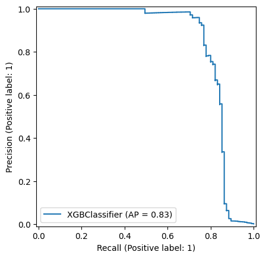
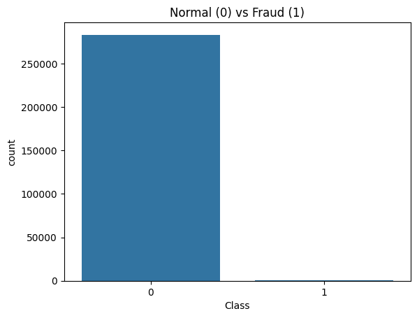

# Credit Card Fraud Detection

Machine learning project that detects fraudulent credit card transactions
in a highly imbalanced dataset (0.17% fraud).

## Problem
Fraud is rare, and a missed fraud costs more than a false alarm. So accuracy is
a misleading metric: a model that always says "not fraud" scores 99.83% and
catches nothing. I used precision, recall, F1 and PR-AUC instead.

## Dataset
- Kaggle "Credit Card Fraud Detection" dataset (European cardholders)
- 284,807 transactions, 30 features (`V1`-`V28` anonymized, `Time`, `Amount`)
- 1,081 duplicate rows removed, leaving 283,726 rows and 473 frauds

## Method
1. Data checks: types, missing values, duplicates, class balance
2. EDA: amount distribution, feature correlations, strongest fraud features
3. Stratified split: 60% train, 20% validation, 20% test
4. `Amount` scaled with StandardScaler, fit on train data only (no data leakage)
5. Models: Logistic Regression, Decision Tree, Random Forest, XGBoost
6. Imbalance handling: [list only what you really ran: class weights / SMOTE /
   threshold tuning / scale_pos_weight, and what happened]
7. Model and threshold chosen on validation data; test set used once

## Results (validation set)
[paste the comparison table here]

## Final model: XGBoost (threshold 0.5)
[paste the test table here]

[One or two sentences, for example: why XGBoost was chosen, and that the
class-weighted version raised too many false alarms.]




## Project structure
```
data/        dataset (not uploaded)
notebooks/   01_data_understanding, 02_preprocessing, 03_models, metrics_demo
src/         predict.py
models/      saved model files (not uploaded)
reports/     charts and model_comparison.csv
```

## How to run
1. `pip install -r requirements.txt`
2. Download `creditcard.csv` from Kaggle into `data/`
3. Run the notebooks in order (01, 02, 03)

## Limitations and next steps
- The test set has only about 95 frauds, so scores can move a few percent
- Features are anonymized, so I could not build features like per-card history
- Next: [only things you have not done, for example a streaming version]
